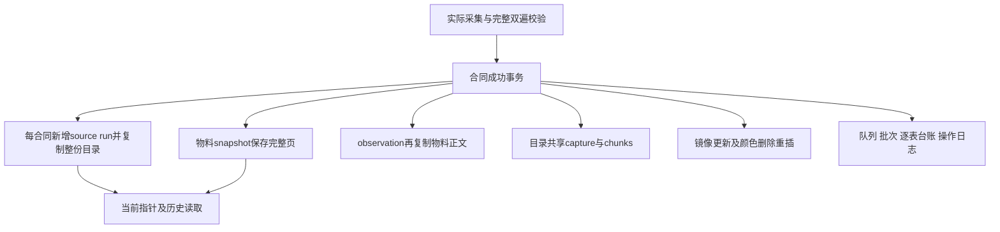
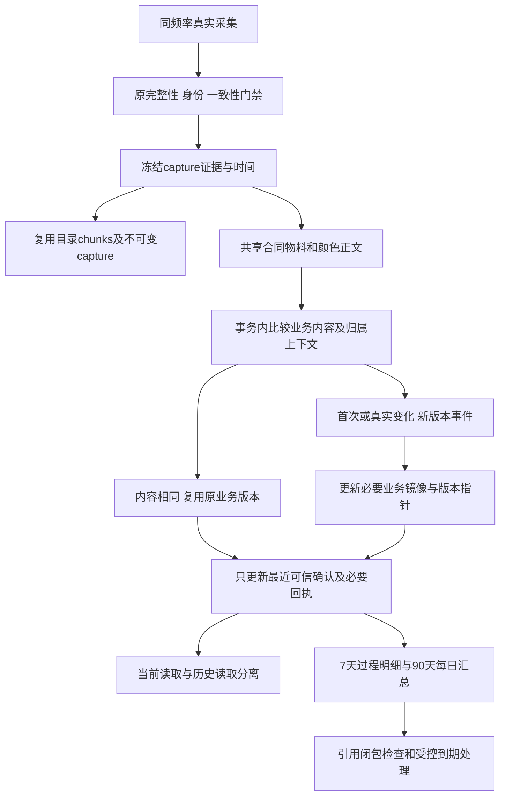

# Issue174-同步存储架构整改与数据库容量治理实施方案

版本：v1.1；日期：2026-11-24（Asia/Shanghai）；状态：**Design / 待用户集中审批，未实施**。Refs [Issue #174](https://github.com/clearisok/zhixu-erp/issues/174)。

## 0. 授权、证据与交付边界

用户在本次聊天附件《已粘贴的文本.txt》中明确（[原文归档](../tasks/active/issue174-design-request-2026-11-24.md)，原始文件SHA-256 `1096e90e88ca2ba415623ddfee4cf81f2230b752a95a05e31583899fb43bade4`）：**“本轮仅批准技术方案设计，不批准代码实施、数据库迁移、历史数据删除、配置修改或部署。”** 数据保留规则是已批准的业务输入，以下技术结构、执行参数、迁移和发布方案仍待批准。本文件中的新增表/字段/CLI、测试和容量收益全部是设计，绝不表示已有实现。

- main设计基线：`10b9a7d827e1c09f152ead58c21f26712d49a619`；GitHub API现场读值与本地对象/HEAD一致。起始fetch连接失败，本轮NETWORK_DEGRADED，未重新刷新Git ref；不是猜用旧分支。独立文档分支`chore/issue174-storage-design`，起点clean，无继承dirty。
- 沿用[原调查](https://github.com/clearisok/zhixu-erp/issues/174#issuecomment-7124101034)和[145表清单](https://github.com/clearisok/zhixu-erp/issues/174#issuecomment-7124103236)，容量时点2026-11-24 12:06:35。12,335,701,015 bytes＝12.336 GB；636订单；三巨表92.11%；完整目录列已压缩正文7.964 GB。**不重跑全库体积调查或全库正文去重。**
- 本轮额外只读核对pg_constraint外键、暂停状态、最近故障事件/尝试各不超过5行，以及源码逻辑引用；READ ONLY事务、10秒语句/1秒锁等待保护。没有新的艾诺科请求、Worker恢复、库写入或参数调整。
- 原调查确认Staging应用标签revision为`a0a9c78c6cccbadf5e635dbb60169f7f87944644`；main与该版本的`server/ainuoke-source`和`database/migrations`无代码差异。现场版本不能倒退写成11-20的0752。
- GitHub尚有[PR172](https://github.com/clearisok/zhixu-erp/pull/172)组合UI验收和[PR173](https://github.com/clearisok/zhixu-erp/pull/173)备份恢复候选，后者head `da1c2653ae6c53a1527bcee60dbdec734cc36553`。本轮不合并它们、不把候选当已进入main。未来发布必须核对实际app/operator/备份脚本/配置指纹和未合并差异，不以本分支覆盖Staging其他整改。
- 范围为Node Server Quote/Order来源存储；不改Browser Repository/IndexedDB/namespace/Seed，不混入根路径legacy ERP，不改订单、单位、价格、财务、生产、关账规则。没有Redis、Kafka、新微服务或独立数据治理平台。

## 1. 推荐决策和分层目标

沿用PostgreSQL、现有共享目录块、串行来源owner、事务发布与配对备份，分开四种东西：

1. **不可变正文**：目录页、合同物料、颜色原始业务事实，同一可信身份/语义/规范版本下相同正文只存一次。
2. **真实状态版本**：首次、业务正文变化、来源绑定/归属上下文变化才创建；A→B→A保留三个有序状态事件，两次A可共享正文。删除/恢复仍是独立不可变生命周期事件。
3. **实际采集确认**：每次真正取数保留时间、范围、校验、任务/幂等/提交证据；无变化不创建业务版本，仍推进成功/尝试/调度状态。普通过程细节按7天保留。
4. **当前指针和每日统计**：指向有效版本与最近一次可信确认；统计/维护失败与业务正确性分别处置。

原始完整历史保护与有限TTL只在**按性质分类＋引用闭包＋可信解决状态**后兼容，不能按表名整表删除。迁移分E1无损表示变换与E2批准保留策略下的过程信息到期，两者分开计量/审批。

## 2. 已确认问题与可复用代码

以下相对链接均指向本设计main基线的实际代码；数字是当前定位，不是已修改位置。

| 事实/风险 | 代码与证据 | 设计处理 |
| --- | --- | --- |
| 自动合同任务直接无条件发布，绕过另一入口的hash replay分支 | [sync-worker.ts:60–99](../../server/ainuoke-source/sync-worker.ts)、[service.ts:121–190](../../server/ainuoke-source/service.ts) | 所有入口统一调用同一事务内内容比较/发布边界 |
| source_runs保存完整discoveryAfter；每合同约108.6KB已压缩目录 | [service.ts:161–169](../../server/ainuoke-source/service.ts)；原调查12run样本13页/634行 | 改引用现有完整capture，不引用可变“当前目录” |
| observation.materials与snapshot.snapshots复制 | [sync-worker.ts:77–87](../../server/ainuoke-source/sync-worker.ts)、[service.ts:169](../../server/ainuoke-source/service.ts)；100/100样本相同 | 一个物料内容ID，两个职责方各自保存身份/manifest引用 |
| 完整bundle/pages hash包含fetchedAt | [contract.ts:17–24、98–100](../../server/ainuoke-source/contract.ts) | 保留旧hash，引入版本化Business/Capture两种hash |
| 已有共享机制可复用 | [catalog-evidence.ts:12–58](../../server/ainuoke-source/catalog-evidence.ts)、[0055](../../database/migrations/0055_ainuoke_shared_catalog_evidence.sql) | 复用chunks、save/load/hydrate，不重建目录存储服务 |
| source reader直接从旧pages时间判新鲜度，且generation用于到料依据 | [reader.ts](../../server/ainuoke-source/reader.ts)、[source-adapter.ts](../../features/ainuoke-material-progress/source-adapter.ts)、[material-arrivals/source.ts](../../server/material-arrivals/source.ts) | 分离首次版本时点与最后验证时点，generation只随事实/上下文变 |
| audit hash状态无变化仍更新batch；颜色每次先删后插 | [sync-audit.ts:266](../../server/ainuoke-source/sync-audit.ts)、[repository.ts:416](../../server/sales-orders/repository.ts) | 条件更新、稳定颜色身份的差异化写入 |
| 自动刷新仍追加3类operation_logs | [delivery-plan-source-refresh.ts:77](../../server/sales-orders/delivery-plan-source-refresh.ts)、service、worker | 自动过程7天；真实变化、人工/权限审计长期，按明确分类区分 |
| 诊断写失败/回调失败会阻断来源采集 | [catalog-diagnostics.ts:21–31](../../server/ainuoke-source/catalog-diagnostics.ts)、[session-collector.ts:65–67](../../server/ainuoke-source/session-collector.ts)、[sync-worker.ts:229–238](../../server/ainuoke-source/sync-worker.ts) | 先保留安全含义；详细分级见§9，不能直接取消暂停 |

可复用`validateBundle`、`previewCatalog`、`previewAdditions`、`validateSelectedSourceOnce`、`pagesValid`及现有report adapter；`boundOrders`/sourceActor/RBAC、归属写围栏、队列在途唯一约束、请求回执、`commitWithSyncAudit`和配对备份。预算、完整双遍、账号/合同身份、Price及未知字段保护、手动优先和有限重试保持。

## 3. 当前结构与完整引用边界

### 3.1 主体与数据库外键（本轮现场确认）

| 对象 | 当前关键字段/主键 | 保护/引用 |
| --- | --- | --- |
| ainuoke_source_runs | id；source_key、captured_at/created_at、discovery/discovery_hash、content_hash、order_scope/hash | profiles.latest_run_id→(source_key,id)；snapshot.run_id→id；UPDATE/DELETE不可变；发布/归属/上下文触发器 |
| ainuoke_material_source_snapshots | (run_id,sales_order_id)；sales_contract_no、snapshots/content_hash、source_link_id、captured_order_version、attribution_change_id | heads及material_arrival_plans→复合PK；source link/归属FK；不可变与当前物理订单发布保护 |
| ainuoke_contract_observations | id、UNIQUE(job_id)、(source_key,source_id,id)唯一；evidence/hash、captured_at、capture_evidence_id | job复合FK；contract_sync_state.observation_id→复合键；不可变 |
| catalog_capture_evidence / evidence_chunks | capture UUID与(source_key,content_hash)；chunks(source_key,content_hash) | catalog_runs、observations→capture有FK；scan_pages→chunks有FK；**capture.directory内rowsHash是JSON逻辑引用** |
| catalog_runs/entries | run(source_key,request_id)唯一；entries(source_key,source_id)且合同号唯一 | profiles.catalog_run_id、entries.observed_run_id→run；生命周期events→出现/确认run；不可变 |
| jobs/requests/capture_attempts | job及request身份、root/retry/capture关联、result JSON | observations、manual requests及重试/未知恢复依赖；不能只清failed/complete状态 |
| audit_batches/tables/events/record_state | 批次、逐表、状态、publication_ids/job_ids/capture_ids数组 | tables/events/record_state及diagnostics→batch FK；数组/文本publication ID没有完整FK保护 |

结构依据：[0012](../../database/migrations/0012_ainuoke_server_source.sql)、[0018](../../database/migrations/0018_order_effective_attribution.sql)、[0020](../../database/migrations/0020_order_attribution_write_guards.sql)、[0022](../../database/migrations/0022_source_history_context.sql)、[0039](../../database/migrations/0039_material_arrival_plans.sql)、[0053](../../database/migrations/0053_ainuoke_catalog_followup.sql)、[0055](../../database/migrations/0055_ainuoke_shared_catalog_evidence.sql)、[0057](../../database/migrations/0057_ainuoke_catalog_scan_checkpoints.sql)、[0058](../../database/migrations/0058_ainuoke_sync_audit.sql)、[0059](../../database/migrations/0059_ainuoke_catalog_diagnostics.sql)、[0060](../../database/migrations/0060_ainuoke_contract_lifecycle.sql)。历史SQL只读，后续新增migration，不改已发布checksum/序号内容。

### 3.2 不能被外键枚举替代的读写/逻辑引用清单

| 边界 | 当前依赖与后续适配要求 |
| --- | --- |
| 全部写入口 | service.captureSource（全量/selected）、sync-worker.publishContract（自动/手动/重试/重启）、bounded-material-refresh、group-refresh、binding/additions、historical-material-publication、material-archive；首次接纳、离线历史重放必须走同一新版publisher，不能遗留旁路 |
| 当前物料和到料计划 | reader读取run.discovery/snapshot，校验旧hash/归属/sourceLink；material-arrivals/source的generation及store中的data.source（JSON）保存runId/contentHash。plans有FK，**plan_versions的before/after JSON同样扫描并保护**；不能只迁当前plans |
| 历史列表/详情 | history.ts按run.created_at,id游标，重建旧目录与页hash；当前详情对6087050有专门限制，6087051历史支持不足应如实保持，单列兼容补齐测试，不能以迁移顺便改映射/对外历史语义 |
| 目录详情/接纳 | catalog-detail/hydrateContractEvidence、preview/adopt、catalog intake receipts.observationId；原requestId重复应复用已存回执，不能因TTL误再建单 |
| 补发/恢复 | historical-material-publication依赖job complete、capture账号、observation hash及旧时间；material-archive只承认原采集时间，不完成当前队列。sync-recovery、catalog-capture先查不可变提交回执；备份supervisor禁止unknown自动恢复 |
| 审计/导出 | audit-backfill依赖job.result.publicationRunId/orderId与observations；audit-catalog-reconciliation需要上一个完整capture；auditPublished读取前run/颜色作基线；audit-query/routes/Excel及系统设置同步记录页要体现“已过详细保留期”和每日汇总，不能补0或伪造完整明细 |
| 删除/恢复生命周期 | catalog-lifecycle重建完整两遍并校验last_seen_run/confirmed_run；0060 events是长期证据，不能把这两个run列入普通成功日志TTL |
| 订单归属及人工确认 | normalization-preview统计snapshot/未知引用；normalization-full-evidence把observations/jobs等to_jsonb纳入证据哈希；重新表示会改变物理hash，应保存迁移前证明并做语义等价适配，不能重写已确认人工依据 |
| 颜色/关账/生产 | sales_order_color_identities稳定ID与各引用保持。closing.month-plan.source_observation当前存数量/颜色fingerprint而非直接run FK，仍是长期快照；executor_basis、commercial/production JSON按各schema解析，不全局替换UUID/哈希 |
| 运维与测试 | backup-local-ainuoke、isolated-source-demo-entry、verify-isolated-runtime、配对backup的row-sha256-multiset；改格式后技术行hash必变，原备份先证明完全恢复，再另做迁移业务等价比较。CLI/session/PG/历史/UI/恢复夹具覆盖旧新混读 |

**保护闭包根**：当前heads/state/profiles、所有正式业务版本（含JSON）、真实来源变化/删除恢复事件、人工/权限审计、未解决incident/unknown、在途/待恢复/retry链、必要幂等回执、法律hold、迁移/回滚hold。沿run→snapshot/capture/content、observation→job/capture/content、capture.directory→chunks等边传递。非根普通日志之间的互相引用不能永久pin全部过程数据；对无根过期子图按依赖顺序整体清理，任何未知边先阻断该分区。

## 4. 整改前后数据流

### 4.1 当前

### 4.2 目标

共享只发生在**取数和校验完成以后**，不减少报表读取，不把历史目录当新的after遍，不按hash相同跳过双遍/账号核验。原始历史重建使用原capture；当前读取使用最新验证capture，不能把旧页fetchedAt改成今天。

## 5. 目标存储契约（拟新增，不是DDL执行清单）

### 5.1 保留、扩展与逐步停止内嵌的结构

| 表/字段 | 目标表示 | 兼容与约束 |
| --- | --- | --- |
| source_runs | 增加storage_version、business_hash_version/hash、record_kind、directory_capture_id、origin_observation_id；保留id/source/order_scope/原时间与旧hash | 新v2 discovery用空数组占位、明确discriminator；directory_capture_id→同source/account capture。legacy discovery原样可读，旧hash不重解释；新run只代表状态变更/必要上下文事件 |
| material_source_snapshots | 增加material_content_id、capture_manifest、storage_version、business_hash；原复合PK/归属/sourceLink上下文不变 | snapshot.snapshots由内嵌变共享引用；manifest是当时页顺序/原fetchedAt/hash/身份映射，不复制业务values；旧内嵌兼容 |
| contract_observations | v3 evidence仅小manifest与明确material_content_id/color_content_id，新增结构化FK列及业务版本关联 | 每次实际成功仍可有观察，但它是采集确认而非业务版本；通常7天，当前/真实变化/正式引用pin的保留。保留job唯一及hash校验 |
| catalog_capture_evidence / chunks | 延续现有v1；source_runs可引用现有capture。必要时增加hash/storage版本 | directory的时点/页顺序不可变；chunks本来已共享，不把整个目录复制到新增表。旧只有after遍的run按after_only证据表示，**不补造before遍** |
| heads及contract_sync_state | 业务run_id与最近verified_observation_id/last_verified_at分离；保留last_attempt/last_automatic_attempt/error | FK验证确认记录与同source/account/合同/业务hash一致；无变化不改run_id，仍更新可信确认和调度。最后一次确认是根，不按7天盲删 |
| catalog_entries/profiles | 内容字段仅差异写；观察/目录scan新鲜度单独记录 | latest完整目录确认仍可每周期前进；目录run是采集证明，不因无新业务版本省掉删除/恢复门禁 |
| audit_record_state | hash未变不UPDATE；batch_id改成“最近内容变化基线批次”语义，scope级最新确认由批次/状态保存 | 原batch FK将长期pin大量旧日志；需迁为可选legacy定位＋结构化永久业务版本基线，新行不靠保留普通batch才能比较。历史batch引用先保护/受控退役，不能直接置空后丢依据 |
| 混合日志/过程表 | 加retention_class、schema_version及适用的resolved_at/hold；重用既有时间/状态 | 旧记录默认unclassified/protected。不能根据entity_type=SalesOrder推断人工/自动；actor、命令路径、内容变更及来源证明一起分类 |

### 5.2 必要新增表，控制在四种职责

1. **ainuoke_contract_contents**：共享物料/颜色正文。UUID PK；kind=materials或colors；source_key、account_fingerprint、source_id、完整合同号、report-set/schema/projection/hash版本、business_hash（SHA-256）、body JSONB、canonical_size/created_at。唯一键含全部可信scope＋kind＋hash版本＋business_hash；FK引用必须带scope/kind检查。body不可变；共享候选冲突后逐字节比较规范正文，不相等即安全失败。不同合同/账号/报表语义不跨域合并，不另存重复的整块canonical text。
2. **ainuoke_evidence_pins**：只补足JSON/数组/法律hold/迁移hold等没有可靠外键的根引用。明确owner_kind/owner_id/owner_version/json_path/reason和目标；目标为run/snapshot复合键、observation、capture、目录chunk、content、job、batch等**带类型的可空FK列，CHECK恰一目标**，不是随便table_name+UUID拼SQL。owner为固定业务schema白名单，插入验证owner真实存在且内容确实引用，唯一owner/version/path/target防重复。现有FK继续保留，不用pins替代数据库约束。正式版本的pin与业务提交同事务；owner无法验证只增加保守hold，不允许放行删除。
3. **ainuoke_sync_incidents**：小型故障状态与解决依据。source/account＋scope（source/contract/maintenance）＋fingerprint、first/last_seen、状态/级别、resolved_at、resolved_by/resolution_evidence_ref、必要受保护记录。已解决失败从此时间+30天；重开恢复unresolved并使旧到期计划失效。重复同故障只更新有界计数/末时点，不每tick制造一条永久事件。新发生的独立故障仍新incident。
4. **ainuoke_sync_daily_rollups**：source/account/北京时间date唯一，包含任务/结果/变化/重试计数、耗时统计、正文/字节及维护/容量metrics。保留90天。容量每日快照也放在这张表固定schema的capacity对象；无需再建监控平台。过程清理结果按日/类别计数并保留有界错误码，不为每批永久写一条operation_log。

迁移checkpoint和旧→新表示对账清单使用现有受控备份目录的独立manifest，内容哈希、原ID/旧hash/新引用/批次校验点组成；本轮不新增常驻迁移服务/任务平台。后续DDL编号从实施时最新main分配，不能预占0061或改现有迁移。

### 5.3 正文、manifest与读回的具体结构

material正文按报表分段、每段保留固定queryContext业务条件及**所有获准来源行values/真实主从ID**；颜色正文同理。首版canonical schema对同报表内无语义顺序的来源行按“稳定来源键＋规范完整values”排序，重复行保持多重性，内嵌size/业务数组原顺序保留。无可靠稳定键仍可按完整行规范字节排序并保留重复；校验器如果判身份冲突/ambiguous仍原样拒绝或保持未知，不凭排序修好业务数据。

采集manifest逐报表/页保存reportId、page/pageSize/total、原queryContext、fetchedAt、snapshotHash、schemaVersion、行在共享正文中的ordinal向量及原sourceRowIdentity。相同完整sourceRowIdentity可以引用正文里的稳定identity映射，避免反复复制64字节字符串；不同hash版本必须显式保存实际值。重复行映射重复ordinal，不丢行。页metadata及向量只用于**无损重建当次原JSON语义**；不是新的业务正文，也不参与正文变化判断。对实际manifest大小设预算并测量，不能为95%目标省掉必要证据。

现有目录chunks按完整rows（含原identity）hash继续存，共享的是块正文；page boundary改变可能产生新块，这是格式差异，不自动算合同业务状态变化。目录Business Hash按全目录身份/values的多重集合计算，不受重新分页/行排序影响；Capture Hash仍严格保留两遍各页顺序。首版不为优化重分页再增加一个目录服务。

旧hash按旧canonical算法校验，hydrate后结果必须通过旧hash；新Business Hash仅判业务等价，不能拿它替代原snapshotHash或篡改旧hash。调用方依旧得到正常snapshot DTO，但新鲜度来自经过校验的确认上下文；历史DTO保留原fetchedAt。缺块、错scope、manifest越界/重复映射不合法、hash版本未知时拒绝读取/发布，保留上一有效状态。

## 6. 双哈希规范 v1

### 6.1 Business Content Hash：ainuoke-business-content.v1

统一在Node已有source边界计算SHA-256；共享库按同一算法读回验证，Python继续产生来源页证据，不新增第二套业务hash真相。输入带purpose/domain/hashVersion、source/account、sourceId/完整合同号、报表集合/语义schema/projection版本、业务queryContext及完整获准values。对象键以确定性UTF-8字节序排序；明确类型与长度，禁依赖localeCompare/数据库collation/JSONB文本序列化。

| 字段/情况 | v1规范 |
| --- | --- |
| page.fetchedAt、request起止、重试/attempt/trace/batch/run/capture ID | 采集元数据，不进入业务hash；原值完整留Capture证据 |
| page.page/pageSize、分页顺序、snapshotHash | 页证据/派生hash，不是业务内容；按完整验证后报表多重集合判内容。不得在校验前忽略分页差异 |
| sourceRowIdentity | 原始派生指纹，验证并在manifest保留；业务身份从原受信ID及全部values获取；不因指纹算法变化就宣称业务变化 |
| 业务日期、交期、采购/入库/出运日期、源create/updateTime | 业务事实，**全部保留**；不做通用“删除所有时间键” |
| 金额/价格/数量/单位/币种、供应商、规格、状态、hsid及所有获准字段 | 不删除、不舍入、不换算、不按白名单缩小业务正文；仅ImageFile沿已有批准投影排除，其他未知字段仍按原门禁拒绝 |
| 缺字段、null、空字符串、0、false | 各不相同；用显式存在性/类型编码；不trim/NFKC/大小写转换原values来制造相等，业务匹配已有标准化与正文hash不同职责 |
| 数字 | 有限JSON number使用与当前Node模型一致的确定性表示；字符串"1"、"1.0"与数字1互异。原输入已把JSON number 1与1.0解析为同值，不能声称恢复词法精度；超安全范围/不可靠数字不为去重强制转换，拒绝合并或保留为未知。不得经JS浮点计算重写原金额文本 |
| 重复行/同量不同流水 | 不以GoodsID/数量合并；行多重性保留。两个不同明细ID永远是不同事实；完整空数组与缺报表/未完成不同 |
| 行顺序 | 报表顶层无序明细可稳定排序；有语义顺序的内嵌数组保留顺序。首版每report显式声明，仅经测试证明可无序的集合才排序；其他未知数组按原顺序 |
| 删除行/恢复行 | 多重集合变化导致hash变化；目录整合同消失/重现仍原双遍生命周期，不以“空物料”代替删除 |

同scope+SHA-256命中还需规范正文逐值/规范字节相等、长度/类型/版本一致；不使用原调查MD5样本hash作正式合并键。唯一约束冲突处理与读回等价检查同事务，异常hash碰撞为integrity_failure，不另插salt偷偷合并。

业务状态hash还绑定物理order/sourceOwner/sourceLink/attribution epoch/必要业务version上下文；**不将纯采集时间或无关的其他合同目录变化放进本合同状态hash**。绑定上下文变化可创建新的“上下文事件”并共享同一正文，不伪称数量/价格改变；人工商业变更、关账锁定不被这个来源比较替代。

### 6.2 Capture Evidence Hash：ainuoke-capture-evidence.v1

对实际收到并已验证的bundle/页元数据、原行顺序/identity、两遍目录、request/result、source/account/scope、正文引用及规范版本做原样语义SHA-256封装。包括真实fetchedAt、完整性结果和validator版本；验证重建结果后再推进confirmed_at。密码/JWT/Cookie仍禁止保存，复杂诊断仍按现有脱敏投影。记录确认事务ID与可信COMMIT后确认时间；不是WAL精确提交时间。

版本升级采用新字段/规范ID；旧业务hash不可就地重算覆盖。旧新混读按storage/hash discriminator路由；新规范要有跨语言/跨平台黄金向量、碰撞模拟、数字/日期/重复/顺序测试。旧历史因精度或身份缺失无法安全归一时保留原表示并pin，列出容量代价，不猜补身份。

## 7. 原子发布、无变化同步和稳定新鲜度

### 7.1 所有入口共用的事务算法

网络请求仍在现有有界采集owner中；通过完整门禁后，在既有归属围栏、source/队列/订单锁顺序内完成：

1. 重查可信actor/RBAC、source/account、任务在途/原request回执、source binding/物理订单上下文；已完成请求重放原结果，不新增观测或刷新成功时间。
2. 存/复用当前capture及合同正文，验证唯一冲突内容相等。建立有FK/校验的manifest，尚不推进业务head。
3. 读取被锁的当前业务版本；比较本合同的头/颜色/物料Business Hash与归属上下文。比较完整报表，不只看audit.inserted/updated计数。
4. 首次/真实变化：创建state-change run和snapshot（引用正文、冻结本次目录/manifest），写真实变化的长期审计；按差异更新镜像/来源计划，原人工Effective/月份/商业保护保持。A→B→A新增第三个事件，复用A正文，不能把head退回旧事件冒充新变化。
5. 无变化：不INSERT source_runs/snapshots/商业或关账历史；不更新镜像业务字段、不删除/重插颜色。写一次轻量actual observation、最终任务回执及必要审计计数，head仍指原版本。
6. 两种路径都更新last_attempt_at、last_success_at/last_verified_at、latest verified observation、清除可清错误及原规则需要的automatic attempt/next slot。确认记录绑定当前Business Hash和完整最新capture；当前UI显示“最近验证成功”而不是把版本创建时刻当最新采集。
7. 业务写、确认、队列complete/幂等结果、必要证明原子提交；COMMIT回执不确定按原unknown处理，不能当失败自动重试或伪造成功。非关键post-commit确认丢失显示pending，按持久事务回执核实，不重做业务写。

内容变化的事务必须保全引用与必要业务审计；不能把它们移到“不保证送达”的日志队列。所有新接口/CLI由已有session/RBAC与expected-target保护，不新增匿名写入。

### 7.2 grouped/selected、恢复和公开返回值

多合同capture仍组级共享目录，逐合同独立事务；一个合同变化不强制为其他合同建版本。分组接口内部返回每订单`businessRunId、outcome=changed/unchanged、confirmationId、confirmedAt`；旧单run调用方必须逐个适配，禁止假造一个run覆盖所有订单。遗留full-source入口的新模式要求既有per-order heads能力，不能把profiles.latest_run_id当每个订单的新鲜度；旧格式读分支仅用于旧数据。兼容响应若只能表达单run，则保持该协议旧表示直到调用方一并升级，不能静默丢订单；实施验收须证明所有生产入口已升级才算消除重复。

历史补发/离线导入沿原capturedAt和身份验证，只在原授权条件下填缺head或替换更旧来源，不把导入时刻写成最近真实同步，不完成当前queued任务。重启/手动重试复用原durable request链，内容共享不重置预算。删除/恢复事件即使物料正文hash不变仍照常追加，source_deleted仍不调度。

### 7.3 读模型兼容

当前reader同时加载业务版本＋最后可信确认（RR一致快照）。只有source/account/contract/context和业务内容匹配、最新完整校验成功才用确认时间评价新鲜度；失败/unknown保持旧事实和准确状态。历史reader只重建该版本当时证据；不跟随当前目录、不更改旧page.fetchedAt。到料generation/contentHash跟业务版本稳定，last_verified_at不进入人工预览CAS的业务依据，避免每30分钟无变化就使人工预览失效。来源上下文真的变化仍必须拒绝旧preview。

API与页面要分别呈现原始来源时点、最近验证成功、最新尝试/错误；在原有UI组件内适配，无新业务模块。具体UI改动属于后续实施及其路径级release guard，不在本文档PR中发生。过期过程详情返回明确detail_expired＋每日汇总，不伪装全量历史、不把未知填0；真实业务历史和受保护证据仍可读。

## 8. 写放大治理及前后计量

- `audit_record_state`按(row key,hash)条件UPSERT；未变不更新batch。新变化才更新内容基线；scope的最后确认由一行状态与批次代表。记录删除需以完整已校验集合与旧集合差集处理，不能让过期旧key永久留作当前，删除历史由业务事件保留。
- 颜色按稳定source/business key对比：新增INSERT、真实变化UPDATE、确证不再存在的当前slice DELETE；旧业务颜色identity保留。无变化三种DML均0；数量相同但尺码/规格等不同仍更新。不能以重建新UUID代替差异更新。
- 合同镜像只差异更新业务字段，采集时间留确认状态；物料head不变时只更新必要确认字段。依赖mirror.fetched_at/source metadata的读者要一起适配；不得仅加WHERE跳过却让页面长期stale。
- audit batch一次预建＋有界汇总，减少每报告回调/每合同重复改同一大JSON的次数；必要in-flight回执与request trace仍持久。先度量，不在未证明安全前删除过程保护。

同一冻结合同集合/源响应序列/相同次数、相同PG与硬件、相同预热/并发的隔离前后对照：pg_stat_*表INSERT/UPDATE/DELETE delta、pg_stat_wal.wal_bytes与LSN差、db/table/TOAST/index bytes delta、成功/失败/重试、p50/p95/p99耗时。统计含新写共享表、pins、TTL/汇总与索引，不只看旧三表；WAL是集群指标，隔离其他写入并记录checkpoint/背景vacuum。记录actual bytes与payload bytes，不能混用；不重置Staging全局统计。持续新内容测试与完全不变测试分开，备份和TTL开启后再测稳态。

## 9. 故障隔离与当前暂停的独立核对

### 9.1 现场事实和不能确认的原因

有界只读回执显示：控制enabled=true，paused_reason=`catalog_diagnostic_write_failed`；暂停事件2026-11-24 11:16:19.822961北京；最后heartbeat 11:16:20.855。最近对应capture为catalog-contracts/failed，开始11:16:19.638、结束11:16:19.804，requests为null、metrics为空。它是**发布前已知失败**，没有据此把旧业务head认作未知，也没有恢复当前Worker。

`appendCatalogDiagnostic`把非SourceError的数据库异常统一映射成该码；`session-collector`又把recapture回调链失败映射到该码。现有回执不含原SQLSTATE、发生阶段或足够原始因果链，**无法确认究竟是数据库INSERT、校验/回调或其他进度持久化故障，也不能证明磁盘满、数据膨胀或0059缺失是根因**。现场旧证据只有6条diagnostic，并不是容量主要来源。

后续修复建议单独列为R174-DIAG：保留主业务拒绝码，增封闭stage/secondary_code、SQLSTATE分类（不存SQL/参数/密钥）和incident关联；区分pre-IO、recapture、full-validation、pre-commit、post-commit。需要合成故障测试后另行批准实现/部署/恢复；本方案批准不自动授权恢复此次暂停。

### 9.2 分级与作用域

| 故障 | 处理与阻断范围 |
| --- | --- |
| 账号/来源/合同身份、认证/权限/证书不可信；完整目录不可靠；证据hash损坏 | 保留现有source级停止，不能接着发布依赖同一不可信目录的其他合同 |
| 某合同完整业务校验失败但共享目录可信 | 拒绝该合同，保留原head及失败；其他合同只能凭自己的完整可信证据继续，沿用现有有限重采边界 |
| 必要正文、引用、业务变更审计/最终回执写失败；确认不出事务最终结果 | 业务事务回滚或unknown隔离，不能以“日志非关键”吞错。数据库整体不可写时停止新的业务发布 |
| 定向重采证明/诊断是批准重采或完整性判断必要依赖 | 该证明保存失败仍阻断这条重采及依赖范围；共享capture受影响时保留source停止。未经重新证明，不把现有catalog_diagnostic_write_failed直接降为warning |
| 已独立通过必要校验后，额外的非关键展示成功日志失败 | 标maintenance_degraded/incident，保留最小成功回执和可信确认；不撤销已证实业务成功、不自动暂停全source |
| 每日汇总、TTL Dry Run/清理、容量采样失败 | 仅维护退避/告警，停止该轮清理；继续业务同步。统计未成功覆盖的过程记录不清，不把维护失败写为业务同步失败 |
| 备份cleanup不明、进程/锁/租约/业务库状态未知 | 保留既有恢复gate，不能用新隔离规则擅自启动worker或解除管理员停用 |

非关键分类必须在代码中按固定stage/record purpose声明，不由错误字符串模糊匹配或前端参数决定。故障反复时只更新同incident计数，按恢复门槛解决；普通辅助失败不能无限制造永久错误日志。

## 10. 已批准保留规则与清理资格

### 10.1 业务输入（无需再次确认）

| 数据性质 | 期限/起算点 | 处理边界 |
| --- | --- | --- |
| 正式订单/业务，报价/商业版本，财务/生产/关账历史 | 长期 | 从不按普通TTL删除 |
| 人工业务操作与权限审计 | 长期 | 自动任务使用同operator不意味着人工行为；由可信调用路径明确区分 |
| 真实来源变化历史 | 长期 | 正文可共享，事件顺序、原时点、前后关系和证明持续保留 |
| 当前有效来源与必要证据 | 持续 | 当前指针/最新确认以及其传递依赖是保护根 |
| 普通同步成功日志 | 完成/确认时刻起7天 | 与真实变更业务审计分开，未被任何保护根引用才到期 |
| 无变化采集详细证据 | 成功采集/确认终结时刻起7天 | 最新有效确认、幂等/业务引用等例外优先 |
| 已解决失败日志 | **故障解决时刻起30天** | 没有可信resolved_at不得按发生日删除，重开取消到期资格 |
| 临时诊断/分页检查点 | 正常终结时起7天 | 失败incident未解决/任务待恢复的依赖持续hold，解决后属于失败证据的取resolved+30天较晚值 |
| 每日同步汇总 | 对应北京时间自然日结束后90天 | 可迟到修正，不额外延长同日无限生命周期 |
| 本次历史迁移专项原始备份 | **正式迁移验收成功起90天** | 到期前再核对恢复能力、迁移验收及无新回滚hold；日常备份保留策略不改 |
| 未解决异常/未知结果 | 解决前持续保护，之后按适用期限 | 不以failed状态/旧时间替代解决证据 |
| 正式业务引用的历史与证据 | 按引用与适用要求持续 | 原记录看似日志也不得清，传递保护共享正文 |

监控容量记录建议保留90天，随本设计待批准；70%普通、85%严重的磁盘预警也属于待批准技术参数，不是已配置事实。

### 10.2 每一行的资格，不按整张表清理

清理资格=`类别已可信识别 AND 已终结 AND 适用到期时间已到 AND 汇总成功覆盖 AND 无保护根/有效引用 AND 兼容版本支持 AND 非法律hold`；未知类别、缺解决证据、未知JSON格式/未完成引用清单一律not_eligible。多种性质/多个incident共存取最严格/最晚期限；法律及业务审计要求高于普通TTL。正式业务引用不因引用方超过7天自动失效。

operation_logs新增记录由服务端传入受限purpose（manual_business、permission_audit、source_business_change、auto_sync_success、maintenance）；DB约束/可信调用路径复核，不允许客户端自选短期限。旧记录只有可证明由具体自动任务、原回执、没有真实业务变化/人工权限操作才分类，否则长期保守保护。发生真实变更时自动source日志也属于长期业务历史。

例外必须保护：当前订单/头/物料/合同/颜色版本及其证据；报价/财务/生产/关账引用；未解决异常、unknown、在途/queued/retry/待恢复依赖；必要request身份/防重记录；其他有效引用的共享正文及依法保留。手动request的必要幂等结果保存原payload hash、状态与结果身份；大过程detail可按受控compact版本拆出或到期，但旧request不得再次创建业务。无客户端重放需求的自动旧任务在终结、重试链解决且无根引用后才可连同过期观察/明细清理。

### 10.3 统一受控生命周期机制

复用现有运维CLI/调度进程中的独立维护tick，不引入服务。设计接口`storage-retention preview`和`storage-retention apply --plan-hash --expected-target`；preview默认，只返回分类/ID数量/估计bytes/保护原因/最早到期，结果带policy_version、快照cutoff、依赖schema版本和plan hash。真实执行每批重新检查资格，不能把昨天的Dry Run当今天授权。

起始技术参数建议：单批不超过100个主体或8MiB估计payload；单次最多30秒；statement_timeout 2秒、lock_timeout 250ms；每批间隔100ms；在锁冲突/业务负载升高时让步并在下次维护tick继续。具体参数通过隔离性能测试后冻结，不能为了赶清理提高到无界。按terminal_at/ID索引游标，SKIP LOCKED仅跳过候选，不覆盖保护条件；高水位和执行范围固定，不能扫入新任务。

并发安全：业务创建引用/pin与清理必须先获取同source的retention fence（写方共享、清理独占），随后再按**现有归属→source→队列→订单→目标**的已统一锁顺序；不得在已经拿业务行锁后反向取fence。实施前全入口验证锁顺序/死锁测试；body插入与引用创建同事务。清理持fence后锁候选、重复检查真实FK/JSON映射/pins/incident/heads/幂等，再按子到父删除。外键RESTRICT兜底；不CASCADE业务数据，不依靠缓存refcount。持引用事务要么先提交使候选不合格，要么清理先提交后引用创建因缺目标失败并重试正常流程，不能引用到已清对象。

目录capture→chunk的JSON关系由固定解析器展开并做引用覆盖检查；正文GC必须检查所有仍存在的capture/observation/snapshot及pins，不能只查latest heads。即便某引用“理论已过期”，只要尚未按同事务合法删除，就视为有效阻止GC。新未知storage_version阻止该source GC。旧日志互相引用的无根子图可分批先清子依赖再清父；不为了解除FK直接置空未知引用。

### 10.4 不可变保护与执行权限

不关闭全部触发器、不使用session_replication_role/disable trigger绕过。业务版本、正文、生命周期、人工/权限审计依然拒绝普通UPDATE/DELETE。仅对有期限过程类别增加专用受控删除/compact函数；函数固定表/列/类别/状态/引用查询，接受有限候选ID，不接受任意SQL/表名。原immutable trigger只对该受审函数的专属维护有效身份且全部资格重验通过开放，普通会话即使设置同名自定义GUC也不能得到权限。

必要安全条件：维护函数SECURITY DEFINER、固定安全search_path（不信任public/临时schema）、所有表schema限定、REVOKE PUBLIC EXECUTE、最小维护执行角色；运行app不得为表owner/超级用户或拥有维护角色。**本轮只读运维连接quote_trial现场确为superuser/create_role/bypass_rls；这不能证明应用连接同角色，也不能假称现有角色隔离已满足。** 后续先核实app/operator实际DB身份/授权；若同用高权限角色，D批次需设计并验证技术DB角色分离及凭据/配置切换，另列部署授权。它不修改员工RBAC权限；缺少此隔离时TTL apply保持禁用，仅Dry Run。

单批资格、删除、日汇总清理计数同事务。若记录清理结果失败则该批回滚，已完成批不重删；中断恢复从持久进度/候选索引继续。详细执行计划本地短期受控保存；审计库按日更新数量/类别/失败码，必要永久审计只记录策略启用/变更、人工操作/例外授权与迁移验收，避免清一次制造永久无限日志。旧immutable日志不能靠新普通UPDATE打上“可删除”标记；后续迁移采用专用classification procedure并保留分类证据。

## 11. 每日汇总与轻量容量监控

### 11.1 汇总口径及幂等

主键source/account/北京时间自然日，字段至少为planned_roots、actual_contracts、success_attempts、failed_attempts、unknown_attempts、unchanged_attempts、changed_attempts、retries、duration_sum/count、固定桶histogram及p50/p95/p99估计、new_content_count/payload_bytes、db_allocated_delta、maintenance结果。计划按root任务计划时点归日，重试不再加计划；实际合同数是当日实际attempt的distinct sourceId（用有界按合同计数map支持增减），不是attempt次数；成功/失败/变化按可信结束时点归日，unknown单列、未取得数量为null。历史导入/回执replay与本次真实取数分别统计，不伪造成功。

在现有维护tick从尚存的terminal回执提取固定版本contribution，保存applied_revision及之前贡献。一个事务中按旧→新delta更新相关日期行＋标记任务已计入，重复执行零增量；首次失败/后续成功分别属于各自attempt，attempt归属不按后来root成功重写历史失败。跨日请求按上述两种时点拆贡献；晚结束的在途记录受到hold，完成后可修正仍在90天窗口内的计划/结果，不凭空重建更早已到期统计。

分位数采用可合并固定耗时桶并标为估计，不能平均几个p95得到总p95；保留sum/count和histogram版本。需要精确分位数的验收用隔离原始样本计算，监控不长存逐次样本。清理前必须成功提交贡献；汇总失败仅阻止清理、保留原回执待补，不停止业务。汇总本身90天到期不会制造另一个永久逐行归档；受法律/事件引用的个别统计例外pin。

### 11.2 每日容量字段与告警

每天一次优先系统统计：数据库bytes；主要表main/TOAST/index（TOAST索引单列且不重复计）；n_live/dead估计；正文新增数量；成功/真实变化/无变化；最新成功；备份开始/结束/耗时/状态、逻辑归档bytes；df可用/使用率；pg_stat_wal必要差量和pg_wal目录占用；临时文件当前bytes与pg_stat_database.temp_bytes累计差量（注明reset/集群范围），不把累计temp_bytes当当前占用。每日db物理差量要保留基线时点、迁移/回收标识，负值合法。

建议70%普通/85%严重、增长率超过同负载已验收范围（初期无基线时标baseline_missing）、可用空间低于备份/迁移峰值预算时专项告警。告警重用现有日志/运维查看方式；相同状态按incident聚合，恢复后闭环，不每分钟重复永久写入。不将85%告警直接等同于停止所有服务；实际磁盘不足以保证业务提交/恢复时按安全故障门禁。不要把未来监控能力标为已经部署。

## 12. 历史迁移：保护、无损去重、到期处理分开

### 12.1 前置和真实引用清单

E批次前冻结现场最新订单集合，636只是调查时点；采集精确stable ID、source binding、heads/归属、真实变化/删除恢复、未解决/unknown/queue/pending恢复集合，以及引用清单schema版本。扫描数据库所有入向FK、触发器/函数/视图；按§3每个代码读写入口及JSON schema枚举引用。未知UUID样式字段不靠文本替换处理，未知schema/不能证明无引用即hold。pins补录在隔离目标验证，全部业务写路径的引用登记能力先于GC启用。

完整数据库＋对象存储配对备份沿原既有安全流程；冻结/停止服务、备份、恢复演练均需未来具体授权，本轮不做。备份包含角色/权限恢复所需受控信息、代码镜像/迁移ledger/配置指纹（秘密只在私密备份）、全部附件实际bytes/SHA。验证不是只看pg_restore --list或dump hash：原库技术表/序列row-hash multiset与隔离**原样恢复**一致，附件逐对象SHA/长度/引用一致，应用身份/DB migration/关键API通过；再对恢复副本做迁移。

优先独立磁盘或隔离主机、network=none/无源站凭据/不发布端口，确认不会发艾诺科请求。只读copy使用既有备份；不在live库展开11GB TOAST作全库hash。不延长备份超时掩盖重复存储；PR173执行器/压缩差异应先核对版本、独立验收，不擅自把本设计当其部署批准。

### 12.2 E1：无损表示变换（推荐先完成）

1. 在隔离原样恢复副本建立有新schema的目标副本；旧副本与原备份保持不变。按source/时间/原ID稳定游标处理，有限每批事务；manifest存源备份hash、工具/规范版本、范围、旧ID/旧hash、新引用/hash、验证结果及已提交checkpoint。未提交批次不推进；重跑相同输入/版本复用已等价结果，错hash/错版本立即停止。
2. 目录：原run.discovery按实际页提取行块，复用目录chunks；已有capture能严格重建原after时复用。仅after的历史run建立明确`after_only_legacy`描述，不补before、不冒充满足未来删除/恢复门禁。原before/after完整的captured证据保留自己的时点与映射。
3. 物料/颜色：读取原observation和snapshot、校验旧hash、同scope正文按§6规范建立共享内容；分别保存各自原manifest/时间/hash。允许正文跨这两表复用，不强制原采集时间/用途相同。原snapshot PK、runId、observationId、jobId、绑定/归属ID不变，不批量改业务外键或JSON业务快照。
4. 增加新表示后，**每条**hydrate回原JSON语义并通过旧hash，检查报表/行多重性/字段类型/原时点。JSONB早已不保留的HTTP词法/键序不补造；校验采用原系统canonical语义，不能用新business hash代替旧一致证明。
5. 按合同身份/真实时间/原ID确定历史顺序，归纳“状态变化事件”与“仅采集确认”；第一次初始化、业务/上下文变化、A→B→A、删除恢复全部保留。跨同毫秒/顺序不明、旧证据不全不能折叠历史事件，保守保留并列为未分类。旧无变化run可以标`legacy_capture_only`而保留原ID、旧API可解析；E1不删除这些过程记录。
6. 在目标上通过**专用一次性表示转换机制**去掉已验证重复内嵌正文，保存hash/manifest/引用；不在原live表UPDATE覆盖。转换只在持有离线迁移授权角色/明确target的工具中可执行，触发器只放行被验证的等价表示变换，不允许任意改业务字段。普通app没有该权限。
7. 完成整库新旧逻辑引用闭包、当前与历史业务投影对照，保留旧id兼容与manifest。隔离副本checkpoint无新业务写，失败可丢弃该候选重用checkpoint重建，**不删除原库/卷/原备份**。

E1收益是共享正文＋重建紧凑物理存储；物理表行数不要求减少。不能把旧格式中一次完整采集伪装成“原先就没有这次采集”。

### 12.3 E2：期限内主动放弃过程细节（独立执行范围）

对已分类且无保护根的普通成功、无变化详细证据、已解决失败、临时检查点应用7/30天规则；提前生成适用90天汇总。选择清单列出expiry_basis、解决证据、保护闭包检查、原技术ID数量/bytes及会失去的查询能力。被业务、恢复、幂等或法律引用的都保留。原始失败没有resolved_at时不得按“以后成功过”推定解决，需可信故障链/人工解决结论。

E2主动放弃的是已批准生命周期内不再需要的过程详情，**不是无损去重**；报告分别列E1共享减少bytes、E2到期释放bytes。旧过程详情API在过期后明确解释，不宣称与迁移前每一项技术详情完全相同；所有正式业务投影、真实历史与受保护证据必须等价。若用户只批准E1，E2与实际TTL apply保持关闭。

### 12.4 切换、回滚和专项备份期限

推荐**维护窗口内独立紧凑库切换**，避免在83%已用原盘上重写巨表。先演练得到耗时/峰值并冻结操作单，再批准Staging窗口：排空已知在途、保全queued/unknown；按现有门禁短停唯一worker及业务写入口，生成最终配对备份/快照；在隔离资源完成同版确定性迁移和全量校验，重绑精确app/operator目标后无写smoke，再受控开放业务并观察。

没有经过验证的CDC/双写协议，不能假称后台复制期间人工写入会自动合并。若最终迁移超窗口，留旧库继续服务并取消切换；不为了缩短停机增加未验证CDC。整个live库最终一致迁移的停写时间必须以演练测量决定，不能现在承诺分钟数。

回滚分界：

- v2写入前：可撤回到旧app＋未变旧库，仍核对migration启动校验。
- v2已写、未到期清理：首选回滚到具备v1/v2解码的兼容版本；旧app不能直接读取空占位字段。可在独立新副本按manifest展开为兼容旧表示后验证，再按新窗口切换；不能运行旧app对新库硬读。
- 新库已经接受人工/业务写：不得直接切回冻结旧库丢失新写。维护停写后取新配对备份，在隔离副本无损反向表示/回放**所有正式业务增量**并完整校验，或在兼容app上前向修复。未证明反向等价前不切。
- E2已到期删除：只能从仍在90天专项原始备份中恢复对应旧过程细节；当前新增业务仍须保留。无备份或超保留期不承诺可逆，真正不可逆点单独批准。

专项原始备份90天计时记录`migration_accepted_at`、批准来源、恢复演练结果、expiry和hold；不是迁移开始/脚本返回0。90天到期前重新证明恢复可用、验收无异议、无回滚/法律hold，再执行另行批准的退役；日常备份规则/旧环境资产不自动变化。

## 13. 磁盘预算与物理回收方式

### 13.1 预算公式与当前限制

当前已知：live DB 12.336GB、根盘可用约39.701GB/使用83%（均是调查时点，不是未来执行基线）；dump曾3.8–6.1GB，压缩/版本不一，不能按此保证下一备份上限。

实施前预算必须现场测量，至少列：`D_old + D_original_restore + D_target_max + B_original + B_new + O_copies + W_peak + T_peak + I_build + A_archives + R_safety`；D_old已在原盘时不能再把全部D_old算成新增，但新副本、回滚副本和旧备份必须逐磁盘列出，防止遗漏或重复。

保守规划例子（**预算占位，不是实测承诺**）：旧恢复副本12.34GB＋迁移目标/工作副本上限12.34GB＋两份备份各8GB＋WAL/临时/索引/归档工作区20GB＋安全余量10GB，已经约70.7GB新增，另加对象存储复制及其他运行增长；若另留独立反向回滚库再加12.34GB。当前39.7GB不足以据此批准同盘并存。推荐隔离磁盘/主机至少按公式实测再预留（初始80–100GB只是规划范围，仍需对象/峰值测量），不把购买硬盘当长期治理方案。

执行阈值：任一阶段预计剩余空间低于该阶段已测峰值＋安全余量即STOP；记录WAL归档/replication slot是否存在与保留体积，不擅自建立逻辑slot或开归档。对象盘、DB盘、备份盘分开核实。并发备份/迁移/清理互斥，不能同时争用最后空间。

### 13.2 方式比较

| 方式 | 返回OS空间/锁与访问 | 峰值与风险 | 本方案定位 |
| --- | --- | --- | --- |
| 逻辑到期删除＋普通VACUUM | 通常供PG内部复用，不能保证等量返还OS；仍有I/O | DELETE产生WAL及死元组，空间不会立刻减；保留引用/不可变门禁 | 后续日常TTL的正常维护，不作为本次缩库证明 |
| 表重写/VACUUM FULL | 重写表，需要ACCESS EXCLUSIVE，目标表访问受阻 | 需新副本及索引/WAL工作空间；锁等待/停机长；其他表和外键读写受影响 | 仅列备选，不默认、不执行；必须另列每表测量和窗口批准 |
| 在隔离库重新物化紧凑表示、校验后切换 | 新库紧凑文件真正减小；切换需短暂停写/worker，最终迁移时长需演练 | 旧新库/备份并存峰值较高，可放独立盘；需保全最终写入与回滚 | **推荐E路径**，优先保证原库不受损 |
| 在线重建扩展/第三方工具 | 可能减少部分锁，但引入扩展/角色/额外复制 | 本环境未验证、峰值仍存在，复杂性上升 | 不列首版依赖，不为本次安装 |

物理释放量以最终新库`pg_database_size`与原库配对时点差量测量；“新库比旧库小”不代表旧卷已删、原盘已返还空间。旧库/备份资产退役是另一个明确不可逆授权，不能为显示df下降自行删除。维护窗口上限、最大阻塞、RPO/RTO与失败取消条件在隔离演练后填写具体值，缺测量时禁止预约自动执行。

## 14. 容量收益、可行边界与目标

原调查的99.38%仅是6087051逻辑变更计数，不能当全合同所有字段无变化率；100样本87份可共享不是全库去重率。**本轮未全量解压/迁移，所以没有实测1GB/2GB或95%收益结果。**

- A首先去掉source_runs每合同完整目录复制，原列已压缩7.964GB，约占数据库64.56%；仅从12.336机械减此列体积约余4.371GB，尚有TOAST/索引/其他历史，不保证真实物理释放量相同。
- B共享物料跨表正文＋相同业务内容跨采集复用，可继续降低约2.9GB大类中的重复；必须在隔离原始备份上全量按scope/版本/多重性计算唯一正文、manifest和保护历史，不能用100样本外推。
- C把完全不变业务版本DML降到0，仍有小型确认/回执/必要审计；D限制可过期细节的稳态数量；E紧凑物化才体现OS/库物理缩减。

预测公式：`D_target = 业务长期数据及索引 + 真实变化事件/共享唯一正文 + 当前保护证据 + 7天普通细节 + 30天已解决失败 + 未解决/幂等/法律hold + 90天汇总/容量 + PG辅助空间`。专项原始备份在外部单计，不藏进目标库数字，也不因1GB目标撤去备份。

原库public表平均摊销166,122 bytes/run；同负载争取95%降低意味着每成功确认含全部新结构/索引的新增分配预算约**8,306 bytes**（这只是反推预算，不是已做到）。无变化manifest/逐报表审计若已超过预算，应实测说明并优化表示，不能删必要来源事实。按两完整运行日约11,622次/日，95%对应新增约0.0965GB/日以下；按7天平均6,057次/日是约0.0503GB/日。两个负载不能混着比较。

1–2GB是否可达取决于唯一正文、真实变化和pins，以及7天详细确认的实际存储；即使95%日增量达标，7天明细约0.35–0.68GB再加必要历史，1GB仍未必可行。新合同/真实变化增加后的长期增长合法，不能把95%设成任何负载都必须达到的硬编码。实施阶段提供E1/E2分项、7天稳态和不少于24h实测，未达到时提交真实原因/可行新目标供批准，不改业务保护来凑数字。

## 15. 批次、迁移与发布依赖

建议保留A–F逻辑Gate，工程可合并A+B、C+D、E+F验收材料，避免六次重复部署；每个可靠Gate仍独立commit/接力/精确远端交付，不把阶段进度只留dirty。

| 批次 | 实际拟改动/数据库方式 | 依赖与关键验收 | 主要风险 |
| --- | --- | --- | --- |
| A 目录引用 | additive source_run目录引用/discriminator；解码reader/history/audit/CLI；复用catalog chunks/capture | 旧/新混读和原hash重建；所有写入口不再内嵌完整目录；不改采集频率/双遍 | 漏掉旧reader、旧app启动或历史after-only被误当完整双遍 |
| B 共享正文/双hash | content表、snapshot/observation明确FK/manifest、新hash字段；中央publisher/历史导入适配 | A；材料/颜色等价及并发冲突；旧hash原值、业务字段全保留 | 精度/类型/重复/语义排序漏事实、跨域误合并 |
| C 轻量同步/差异写 | 无变化不建run/snapshot；heads确认字段、generation/freshness、镜像差异、record_state内容基线 | B；首次/变化/A-B-A/删除恢复、freshness及人工preview并发 | 页面错误stale、计划被重置、旧协议只返回单run |
| D 生命周期/隔离 | pins、incidents、rollups、适用分类字段/专用过程；技术DB角色若缺隔离须单独配置切换 | 全引用写入已覆盖；Dry Run默认；先汇总后清理；触发器/权限/GC竞态测试 | 混合日志错分、未知引用、维护角色过权、错误解除暂停 |
| E 历史迁移/物理回收 | 隔离E1、选定E2清单、紧凑库、manifest/恢复/反向表示；批准窗口后才切换 | A–D兼容版、完整备份实际恢复、峰值预算、逐项等价；E2另批准 | 原盘不足、人工新写丢失、原始hash/回滚链断裂 |
| F 监控/组合验收 | rollup容量字段、告警/运维呈现、统一候选镜像及持续实测 | A–E适用范围；两轮自然调度＋≥24h容量观察、正常备份/故障恢复 | 与未合并Staging整改互覆盖、只看功能两轮就宣称长期目标通过 |

迁移版本兼容矩阵（代码依据：[migration-runner](../../server/db/migration-runner.ts)、[startup](../../server/startup.ts)、[server入口](../../server/index.ts)）：旧app+其精确旧迁移账本按原方式运行；**新兼容app+缺少其必需migration的旧schema仍必须启动失败**，不能用feature flag或只读模式绕过verify-only。新兼容app只有在对应扩展schema及精确checksum账本通过核验后，才同时解码旧内嵌数据和新引用数据；这里“兼容旧格式”指数据表示，绝不代表允许缺迁移运行。**旧app+扩展schema在现行账本门禁下即不兼容，无论是否已写入v2数据**；回退旧程序必须指向已保全、与旧账本匹配且不会丢失新业务写的独立旧库/受验证转换副本。原migration完整性与启动门禁保持，不设计自动降级；min reader/writer约束只是附加保护，不能代替原门禁。TTL新旧读写同时存在时保持禁用；不启双写完整正文作为长期状态。集成候选必须准确合并已批准而尚未上main的Staging有效整改，冻结source SHA/image/digests，独立CI/浏览器验收，不自动合并任何正式PR或部署Production。

## 16. 具体测试与验收清单（后续实施执行，本轮未运行业务测试）

| 场景 | 必须可观察的通过标准 |
| --- | --- |
| 相同目录连续N次、多合同共享 | 实际请求/双遍次数保持；同scope相同目录正文不新增；每次capture可原样重建时间/页顺序；单合同run不内嵌目录 |
| 同合同物料连续相同、仅fetchedAt变化 | 业务run/snapshot/镜像业务DML＝0；内容行＝1；confirmation/成功及调度更新；页面fresh、人工preview不因时间冲突 |
| 需求/采购/入库/出运数量分别变化 | 各自单变量新增真实事件，数量/单位/来源ID准确，其他节点不被误改 |
| 规格/供应商/单位/价格/业务日期变化 | 进入Business Hash；不舍入、不换单位、不回写报价CCT；A→B→A有3事件/2正文 |
| 来源新增/删除/恢复、空/缺/不完整 | 新合同仍正常建档；原双遍删除恢复保护保留；完整空是事实，缺/不完整/unknown不覆盖旧head |
| null/空串/0、重复行、顺序、精度 | 严格区分类型/存在性；多重性不丢；顶层无语义重排无伪变化、内嵌有序改变可识别；不越精度 |
| 手动/自动并发、共享正文并发 | 在途唯一/原锁序/请求幂等；同正文冲突后等价复用；不同内容碰撞模拟安全失败；无重复业务版本 |
| 失败重试/事务中断/COMMIT未知 | 回滚不推进head/hash；已确认成功可查原回执，unknown不自动重提；故障hold不清 |
| v1/v2/v3混读及原历史重建 | 每个storage/hash版本按自己的hash通过；缺块/错scope/hash损坏安全拒绝；原fetchedAt不伪造 |
| 到料、归属、颜色/尺码、关账等依赖 | runId/JSON引用和稳定颜色ID有效；原计划/人工Effective不被重置；冻结月份、executor/财务依据准确 |
| TTL边界/解决时间/法律与业务引用 | 7/30/90天在精确边界；解决+30不是发生+30；重开失效；当前/业务/幂等/在途/unknown均不删 |
| 清理重复/中断/竞态 | preview无写；旧plan执行时重验；有新pin则跳过；共享正文仍有任何有效引用就不删；部分提交不重复计数；普通app/GUC不能绕过trigger |
| 汇总重复/跨日/迟到/重试 | root计划不重算；distinct合同数正确；attempt结果分开；contribution revision零重复；histogram可合并且分位估计标明；失败不停止同步 |
| 备份/恢复、迁移断点和回滚 | 先原样恢复全表/序列/对象技术hash一致，再迁移业务等价；中断从checkpoint确定重启；新写保全；不能旧库直接覆盖新库 |
| 维护故障及必要证据故障 | 普通TTL/统计失败仅维护退避；必要身份/证据/事务失败仍安全阻断；原暂停不因上线自动清除 |
| 可比性能/容量 | 同集合/内容/次数/环境全部DML、WAL、分配bytes与p50/p95/p99；真实变化/无变化/稳态分开；不低于可比同步性能 |
| 实际Staging及页面 | 保留其他已批准整改；订单/报价/物料/生产/财务/关账和权限/附件UI真实回归；至少两轮自然调度与≥24小时实际容量观察；无24h只标功能验收 |

复用现有测试目标：`test:ainuoke-catalog`、`test:source-deleted`、`test:ainuoke-selected-source-once`、continuous/自动runner/历史发布/审计测试、`test:material-arrivals`、order-source-evidence/material-history/归属/商业/closing相关集成、persistent-recovery、备份Python回归及相关真实浏览器用例。实施时按package.json实际名称冻结，不凭此描述声称现成有新测试。新增双hash/TTL/GC/迁移黄金向量与不可变/权限/故障注入测试使用自有临时PG/合成源，不接真实源站/共享DEV数据。

每个实施PR按范围typecheck/lint/test/build、Server build和PG/SQL/恢复检查；所有PR均运行`npm run check:release-baseline -- --base-sha <当时核实完整main>`和`npm run test:release-baseline`。UI路径影响记录及V2/V3明确批准另按release guard，不自动更新旧截图/文档hash掩盖失败。

### 16.1 历史业务等价验收矩阵

以最终备份时点最新集合为准，保存逐ID/逐版本canonical事实、精确decimal文本、未知/null及关系，不只核总数：

- 全部订单stable ID/来源绑定/sourceOwner/归属与当前物料head；需求/采购/入库/出库/出运数量及各自单位/流水ID。
- 颜色/尺码/矩阵、数量、source_deleted/restored事件和原确认run；真实来源变化时间线（含A-B-A）。
- 全部报价/PV/CCT、人工操作/权限审计、人工计划、生产/财务/关账及冻结历史和嵌入证据。
- 用户/角色/权限不变；附件对象bytes/SHA/引用、序列和必要幂等身份不变；未解决incident/unknown/在途/恢复依赖保全。
- 所有原API代表性投影、历史列表/详情、导出和source parser输出等价；明确区分E2合法到期技术详情与正式业务历史。无法解析/尚不支持的历史格式保守保留并列限制，不补造“已验证”。

## 17. 最终实施授权包及剩余待审事项

以下都是未来执行前要给用户集中批准的**具体操作范围**，不是反复确认已批准的保留规则：

| 授权包 | 需固定的可审核内容 | 当前状态 |
| --- | --- | --- |
| A/B/C工程 | 本v1.1结构/双hash/入口/读者兼容及差异写范围、独立分支/PR、测试清单 | 本轮只设计，未批准实施 |
| D工程与启用 | purpose分类/所有引用注册、TTL参数、权限隔离、incident解决流程、90天监控与70/85预警 | 保留期限已批准；具体机制/技术DB角色配置及apply尚未批准 |
| 隔离演练 | 明确备份来源/目标盘主机、预算、允许只读复制/隔离恢复/候选迁移、禁止源站请求 | 需具体目标/资源授权，不能操作live或假定空间足够 |
| Staging发布/恢复 | 组合source/image/app/operator/backup指纹、最新迁移、备份验收、窗口、原暂停R174-DIAG处理与现有门禁 | 独立批准；不因P0或设计通过自动恢复Worker |
| E1最终迁移/切换 | 已测等价/空间/耗时、原库资产保留、新写保护与回滚、明确停写和worker窗口 | 未批准 |
| E2到期及物理回收 | 精确过期分类/数量/bytes/丢失的过程详情、protected/unknown例外、选定回收方式 | 业务期限已批准；实际清理/迁移/任何VACUUM FULL等均未批准 |
| 专项备份/旧资产退役 | 验收成功日+90天、再次恢复证明、无hold、逐资产不可逆清单 | 未批准；日常备份策略不变 |

推荐技术选择已给定：复用目录、单一共享合同正文表、现有PG/调度、独立紧凑库迁移，不再让用户替AI选无关底层实现。尚需以演练完成的事实为：唯一正文全量大小、受保护历史/幂等稳态量、manifest实际开销、1–2GB及95%是否可达、维护窗口/RPO/RTO、目标磁盘/主机、app实际DB权限以及当前diagnostic原故障原因。这些缺口阻止对应实际执行，不阻止本轮提交完整v1.1供审。

## 18. 本轮验证、交付与恢复点

v1.1相对[最初v1全文](https://github.com/clearisok/zhixu-erp/issues/174#issuecomment-7124646434)只澄清§15启动兼容矩阵：旧应用与扩展schema的不兼容早于v2写入；新应用缺必需migration仍拒绝启动。保留规则、业务范围、四种新增职责与实施授权边界均不变。原v1评论/提交/冻结hash不覆盖，以本版本前向替代。

这是文档设计交付：不写DDL/代码/测试实现，不执行迁移/GC/备份/恢复/部署/Source IO，不调频、不改pause。原145表报告是旧实测，本轮只读补充是引用/角色/故障最小查询；缺少全量去重和24小时新运行证据如实保留。

文档结构覆盖用户18项交付及A–F、全部批准保留规则/例外；最终提交前核对相对链接、Mermaid代码块、Git diff与精确main release guard及相关基线回归。旧冻结证据ID/hash保留，新业务输入/决策文档变化用新Git blob及前向supersedes记录，不更新截图hash，不宣称UI/能力维度变化。

NETWORK_DEGRADED时本地设计/提交与Issue/Project API登记分别完成；没有精确远端HEAD就不创建假PR，不用GitHub文件API伪造本地commit。最终branch/commit/checks/remote状态和一次性安全人工交付命令记录在Issue及AI_HANDOFF。Issue保持Open/Design/P0，等待用户集中批准，不进入Ready/In Progress或自动关闭。

参考技术边界：[PostgreSQL 16 VACUUM与空间复用/重写锁](https://www.postgresql.org/docs/16/routine-vacuuming.html)、[pg_dump及恢复格式](https://www.postgresql.org/docs/16/app-pgdump.html)、[统计/WAL/临时文件指标](https://www.postgresql.org/docs/16/monitoring-stats.html)、[SECURITY DEFINER安全search_path](https://www.postgresql.org/docs/16/sql-createfunction.html#SQL-CREATEFUNCTION-SECURITY)。本方案以独立实测验证锁/容量/性能，技术文档不构成环境验收。
