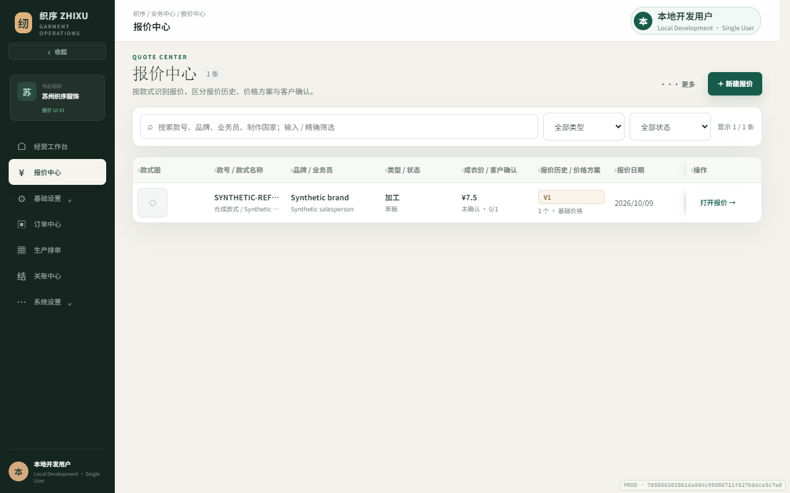
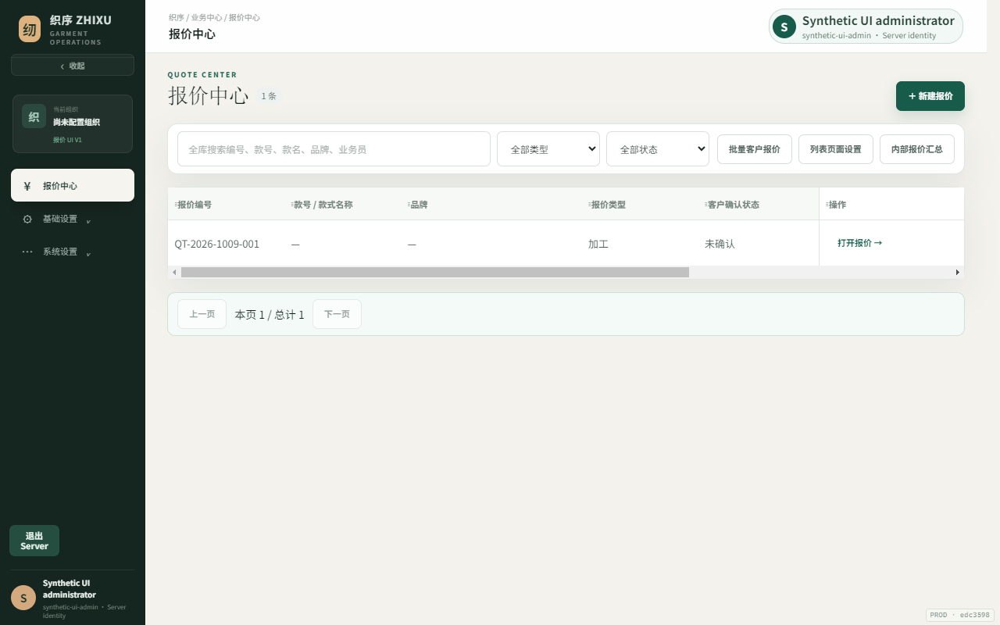
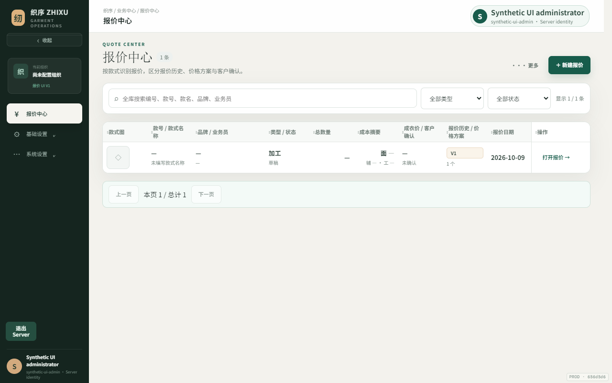
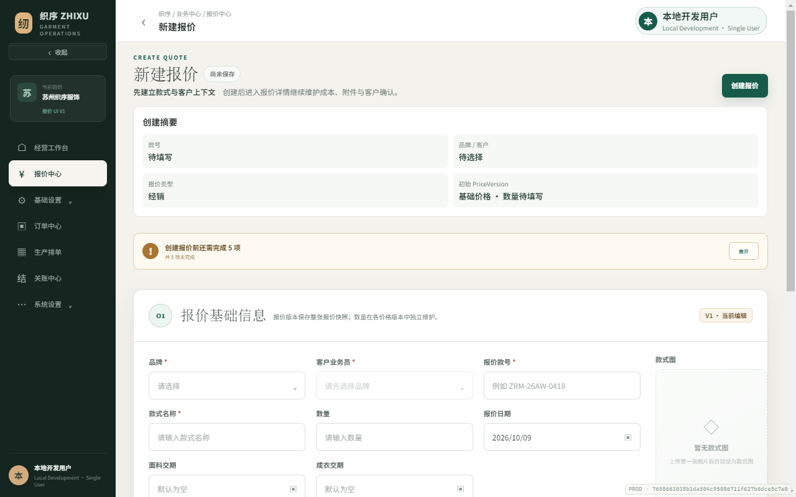
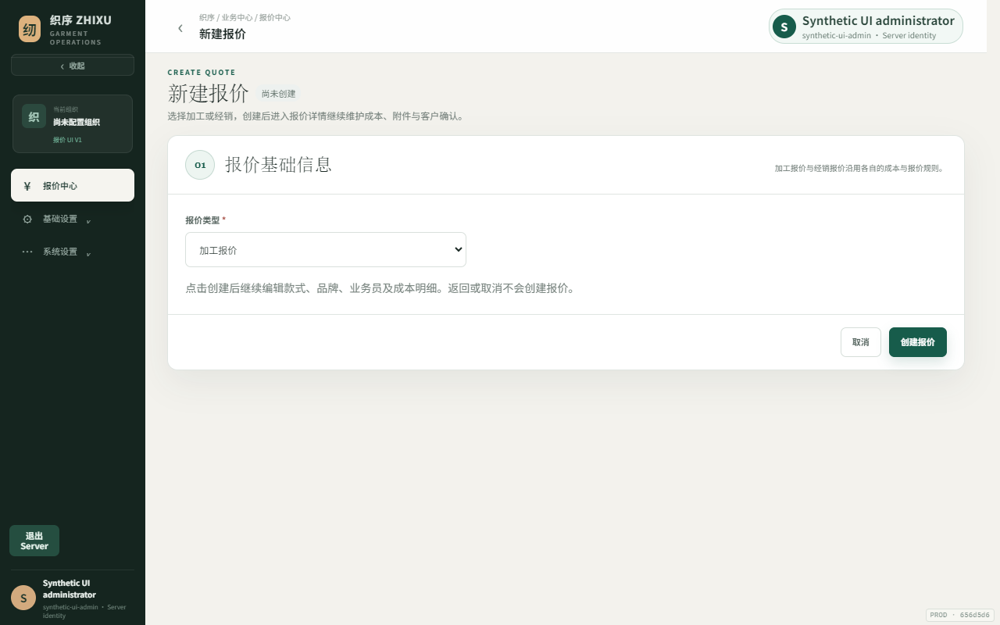
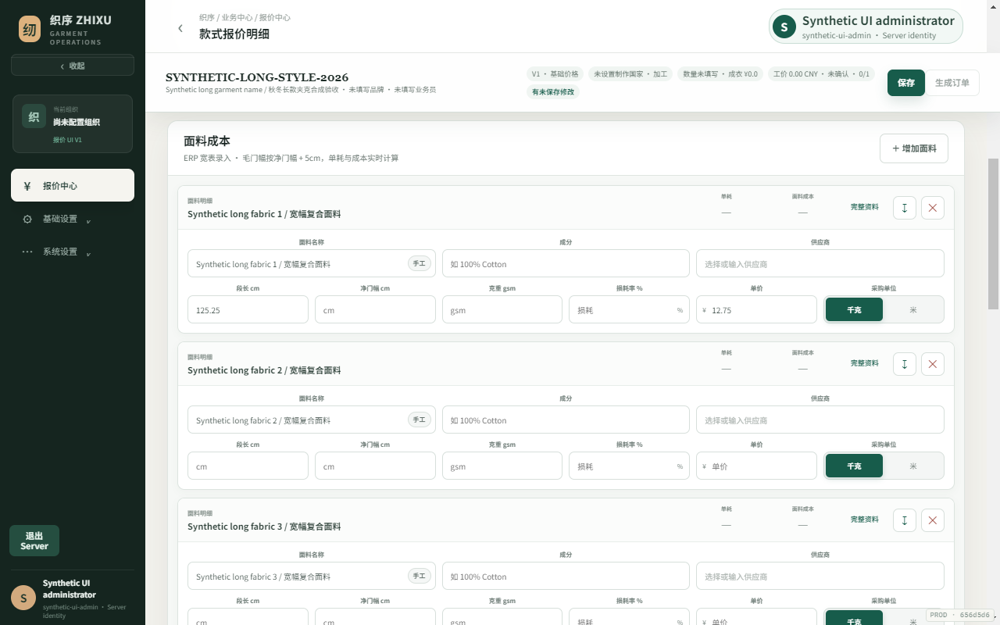

# Quote UI — synthetic visual evidence

PR64 actual archived build `7658663038b1da504c95086711f627b6dce5c7a0` is the visual reference. Before is current merged Server base `edc3598764266de087c0f669f8bcf5452c6d3fd2`. After uses the final runtime source from Gate C `656d5d6` (later commits are tests/docs only). No real trial, customer data, user profile, database or COS was accessed.

Actual Chromium, 100% zoom / deviceScaleFactor 1. Four desktop sizes use mouse/fine-pointer rules (900 is not a phone). Additional 390×844 has touch, coarse pointer and no hover, asserted against the actual responsive Shell/record view. All captures use an owned profile, disposable PostgreSQL/tmpfs and memory attachments. PR64's Browser fixture exists only in that isolated reference profile; it is never imported into PostgreSQL. Its local-user identity is a historical visual reference, not the current trusted Server identity.

146 PNGs: reference12, before56, after78. [Audit, permissions, commands/results and differences](../../active/quote-original-ui-convergence.md). Geometry-only [before metrics](before/metrics.json), [after metrics](after/metrics.json), [reference metrics](reference/metrics.json); no raw business payloads/secrets. ENGINEERING PASS / USER UI ACCEPTANCE PENDING.

## Representative comparison — 1280×800

Original list:

Before Server list:

After Server list:

Original and Server preparation are intentionally not identical: Browser had an unsaved full aggregate, while Server keeps a type-first step until explicit create. Same components/style, no POST on open.

PR83's working costs/sticky/Portal are retained, not rolled back:

## Complete state index

| State | PR64 reference | Before Server | After Server |
| --- | --- | --- | --- |
| empty-list | — | [1920x1080](before/empty-list-1920x1080.png) · [1440x900](before/empty-list-1440x900.png) · [1280x800](before/empty-list-1280x800.png) · [900x800](before/empty-list-900x800.png) | [1920x1080](after/empty-list-1920x1080.png) · [1440x900](after/empty-list-1440x900.png) · [1280x800](after/empty-list-1280x800.png) · [900x800](after/empty-list-900x800.png) |
| new-distribution | [1920x1080](reference/new-distribution-1920x1080.png) · [1440x900](reference/new-distribution-1440x900.png) · [1280x800](reference/new-distribution-1280x800.png) · [900x800](reference/new-distribution-900x800.png) | [1920x1080](before/new-distribution-1920x1080.png) · [1440x900](before/new-distribution-1440x900.png) · [1280x800](before/new-distribution-1280x800.png) · [900x800](before/new-distribution-900x800.png) | [1920x1080](after/new-distribution-1920x1080.png) · [1440x900](after/new-distribution-1440x900.png) · [1280x800](after/new-distribution-1280x800.png) · [900x800](after/new-distribution-900x800.png) |
| new-processing | — | [1920x1080](before/new-processing-1920x1080.png) · [1440x900](before/new-processing-1440x900.png) · [1280x800](before/new-processing-1280x800.png) · [900x800](before/new-processing-900x800.png) | [1920x1080](after/new-processing-1920x1080.png) · [1440x900](after/new-processing-1440x900.png) · [1280x800](after/new-processing-1280x800.png) · [900x800](after/new-processing-900x800.png) |
| draft-detail | — | [1920x1080](before/draft-detail-1920x1080.png) · [1440x900](before/draft-detail-1440x900.png) · [1280x800](before/draft-detail-1280x800.png) · [900x800](before/draft-detail-900x800.png) | [1920x1080](after/draft-detail-1920x1080.png) · [1440x900](after/draft-detail-1440x900.png) · [1280x800](after/draft-detail-1280x800.png) · [900x800](after/draft-detail-900x800.png) |
| one-row-list | [1920x1080](reference/one-row-list-1920x1080.png) · [1440x900](reference/one-row-list-1440x900.png) · [1280x800](reference/one-row-list-1280x800.png) · [900x800](reference/one-row-list-900x800.png) | [1920x1080](before/one-row-list-1920x1080.png) · [1440x900](before/one-row-list-1440x900.png) · [1280x800](before/one-row-list-1280x800.png) · [900x800](before/one-row-list-900x800.png) | [1920x1080](after/one-row-list-1920x1080.png) · [1440x900](after/one-row-list-1440x900.png) · [1280x800](after/one-row-list-1280x800.png) · [900x800](after/one-row-list-900x800.png) |
| filled-detail | [1920x1080](reference/filled-detail-1920x1080.png) · [1440x900](reference/filled-detail-1440x900.png) · [1280x800](reference/filled-detail-1280x800.png) · [900x800](reference/filled-detail-900x800.png) | [1920x1080](before/filled-detail-1920x1080.png) · [1440x900](before/filled-detail-1440x900.png) · [1280x800](before/filled-detail-1280x800.png) · [900x800](before/filled-detail-900x800.png) | [1920x1080](after/filled-detail-1920x1080.png) · [1440x900](after/filled-detail-1440x900.png) · [1280x800](after/filled-detail-1280x800.png) · [900x800](after/filled-detail-900x800.png) |
| cost-rows-detail | — | [1920x1080](before/cost-rows-detail-1920x1080.png) · [1440x900](before/cost-rows-detail-1440x900.png) · [1280x800](before/cost-rows-detail-1280x800.png) · [900x800](before/cost-rows-detail-900x800.png) | [1920x1080](after/cost-rows-detail-1920x1080.png) · [1440x900](after/cost-rows-detail-1440x900.png) · [1280x800](after/cost-rows-detail-1280x800.png) · [900x800](after/cost-rows-detail-900x800.png) |
| scrolled-costs | — | [1920x1080](before/scrolled-costs-1920x1080.png) · [1440x900](before/scrolled-costs-1440x900.png) · [1280x800](before/scrolled-costs-1280x800.png) · [900x800](before/scrolled-costs-900x800.png) | [1920x1080](after/scrolled-costs-1920x1080.png) · [1440x900](after/scrolled-costs-1440x900.png) · [1280x800](after/scrolled-costs-1280x800.png) · [900x800](after/scrolled-costs-900x800.png) |
| conflict-detail | — | [1920x1080](before/conflict-detail-1920x1080.png) · [1440x900](before/conflict-detail-1440x900.png) · [1280x800](before/conflict-detail-1280x800.png) · [900x800](before/conflict-detail-900x800.png) | [1920x1080](after/conflict-detail-1920x1080.png) · [1440x900](after/conflict-detail-1440x900.png) · [1280x800](after/conflict-detail-1280x800.png) · [900x800](after/conflict-detail-900x800.png) |
| paged-list | — | [1920x1080](before/paged-list-1920x1080.png) · [1440x900](before/paged-list-1440x900.png) · [1280x800](before/paged-list-1280x800.png) · [900x800](before/paged-list-900x800.png) | [1920x1080](after/paged-list-1920x1080.png) · [1440x900](after/paged-list-1440x900.png) · [1280x800](after/paged-list-1280x800.png) · [900x800](after/paged-list-900x800.png) |
| all-columns-list | — | [1920x1080](before/all-columns-list-1920x1080.png) · [1440x900](before/all-columns-list-1440x900.png) · [1280x800](before/all-columns-list-1280x800.png) · [900x800](before/all-columns-list-900x800.png) | [1920x1080](after/all-columns-list-1920x1080.png) · [1440x900](after/all-columns-list-1440x900.png) · [1280x800](after/all-columns-list-1280x800.png) · [900x800](after/all-columns-list-900x800.png) |
| all-columns-end | — | [1920x1080](before/all-columns-end-1920x1080.png) · [1440x900](before/all-columns-end-1440x900.png) · [1280x800](before/all-columns-end-1280x800.png) · [900x800](before/all-columns-end-900x800.png) | [1920x1080](after/all-columns-end-1920x1080.png) · [1440x900](after/all-columns-end-1440x900.png) · [1280x800](after/all-columns-end-1280x800.png) · [900x800](after/all-columns-end-900x800.png) |
| brand-portal | — | [1920x1080](before/brand-portal-1920x1080.png) · [1440x900](before/brand-portal-1440x900.png) · [1280x800](before/brand-portal-1280x800.png) · [900x800](before/brand-portal-900x800.png) | [1920x1080](after/brand-portal-1920x1080.png) · [1440x900](after/brand-portal-1440x900.png) · [1280x800](after/brand-portal-1280x800.png) · [900x800](after/brand-portal-900x800.png) |
| cost-values | — | [1920x1080](before/cost-values-1920x1080.png) · [1440x900](before/cost-values-1440x900.png) · [1280x800](before/cost-values-1280x800.png) · [900x800](before/cost-values-900x800.png) | [1920x1080](after/cost-values-1920x1080.png) · [1440x900](after/cost-values-1440x900.png) · [1280x800](after/cost-values-1280x800.png) · [900x800](after/cost-values-900x800.png) |
| historical-readonly | — | — | [1920x1080](after/historical-readonly-1920x1080.png) · [1440x900](after/historical-readonly-1440x900.png) · [1280x800](after/historical-readonly-1280x800.png) · [900x800](after/historical-readonly-900x800.png) |
| viewer-detail | — | — | [1920x1080](after/viewer-detail-1920x1080.png) · [1440x900](after/viewer-detail-1440x900.png) · [1280x800](after/viewer-detail-1280x800.png) · [900x800](after/viewer-detail-900x800.png) |
| loading-list | — | — | [1920x1080](after/loading-list-1920x1080.png) · [1440x900](after/loading-list-1440x900.png) · [1280x800](after/loading-list-1280x800.png) · [900x800](after/loading-list-900x800.png) |
| error-list | — | — | [1920x1080](after/error-list-1920x1080.png) · [1440x900](after/error-list-1440x900.png) · [1280x800](after/error-list-1280x800.png) · [900x800](after/error-list-900x800.png) |
| restricted-cost-list | — | — | [1920x1080](after/restricted-cost-list-1920x1080.png) · [1440x900](after/restricted-cost-list-1440x900.png) · [1280x800](after/restricted-cost-list-1280x800.png) · [900x800](after/restricted-cost-list-900x800.png) |

Touch: [list](after/true-mobile-list-390x844.png), [detail](after/true-mobile-detail-390x844.png).

## Review boundaries

- Thumbnail is a labelled placeholder; no fabricated image/old URL. Server summary has no country/PV-name list metadata; do not infer or expose it from Browser.
- Personal settings are not reset. New defaults and explicit restore get grouped original presentation; old v1 preferences keep independent fields.
- Normal grouped 1280 layout fits; all-column/custom widths scroll inside the table, right actions remain fixed. Costs remain readable at 1280, no Editor rewrite.
- Actual keyboard Enter opens the focused row; Portal, history readonly, restricted cost view, loading, failure/409 and touch actions are captured and asserted. Full business tests cover edits, history, CAS, precision, workflows, exports, downloads and trusted permission isolation.
- Human reviewers still need to approve list/new/detail/cost appearances and preferred personal columns. This is not a deployed image or real UI acceptance.
